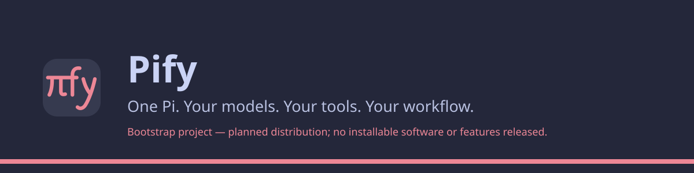

# pify

**One Pi. Your models. Your tools. Your workflow.**

Pify is a planned ready-to-use distribution of configuration, skills, tools, and workflows for the official Pi coding agent. The goal is a portable, model-agnostic setup that builds on Pi rather than replacing it.

**Status:** Pify is in bootstrap: this repository has community guidance and a license, but no installable distribution or released features.

## What is here

- The MIT [license](LICENSE).
- [Contribution guidance](CONTRIBUTING.md), a [code of conduct](CODE_OF_CONDUCT.md), and a [security policy](SECURITY.md).

The approved roadmap will be tracked in [GitHub Issues](https://github.com/fnayou/pify/issues). An issue describes planned work, not a shipped capability. Installation and usage instructions will follow validated releases.

Public branding uses Catppuccin Macchiato Red (`#ed8796`).
